# Arquitectura de Pagos — YAHPOS!

> Documentación técnica + client-facing para entender cómo se integran los medios de pago en YAHPOS! Tanto para el POS (presencial) como para el E-commerce (online).

---

## Índice

1. [Visión General](#1-visión-general)
2. [Customer Display + QR Payments](#2-customer-display--qr-payments)
3. [Transbank Webpay Plus (QR / Link)](#3-transbank-webpay-plus)
4. [Mercado Pago QR](#4-mercado-pago-qr)
5. [SumUp Cloud API](#5-sumup-cloud-api)
6. [Flow — Cuotas Débito / Crédito](#6-flow)
7. [Getnet POS Integrado](#7-getnet-pos-integrado)
8. [TUU Pago Remoto](#8-tuu-pago-remoto)
9. [Matriz de Medios de Pago](#9-matriz-de-medios-de-pago)
10. [Configuración por Negocio](#10-configuración-por-negocio)
11. [Plan de Implementación](#11-plan-de-implementación)
12. [Control de Duplicación de IVA (SII Compliance)](#12-control-de-duplicación-de-iva-sii-compliance)
13. [Flujo Completo de E-commerce](#13-flujo-completo-de-e-commerce)

---

## 1. Visión General

### Arquitectura Actual

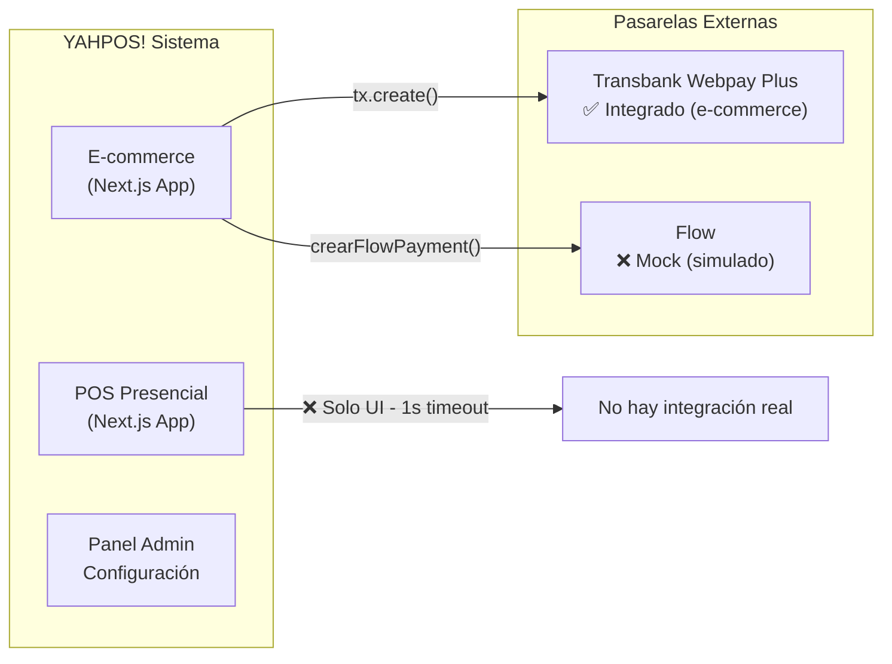

### Arquitectura Propuesta

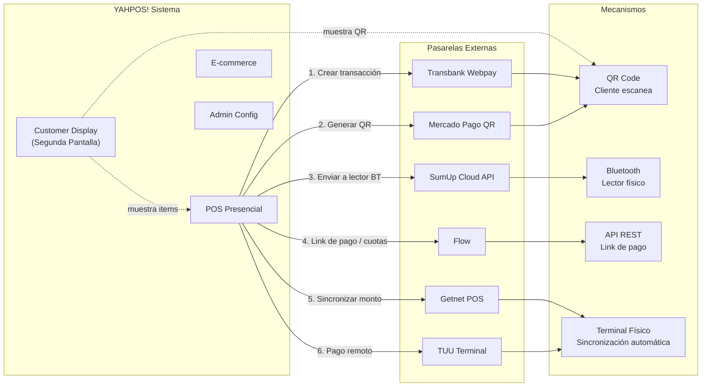

### Flujo General de Pago en POS

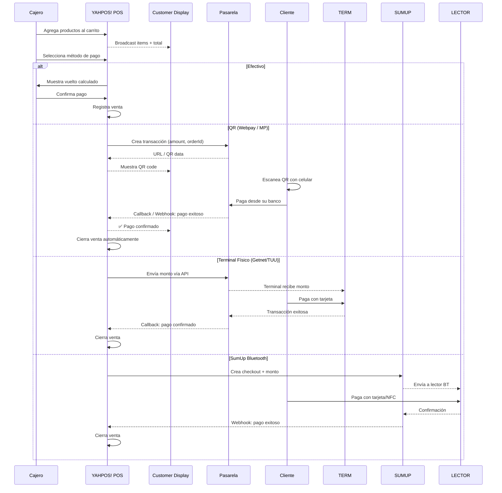

---

## 2. Customer Display + QR Payments

### Concepto

La **Customer Display** es una segunda pantalla (o ventana del navegador) orientada al cliente, que muestra en tiempo real:

- Items escaneados con precios
- Subtotal, descuentos, total
- **QR code** para que el cliente pague con su celular
- Promociones / puntos de fidelización

### Arquitectura de Sincronización

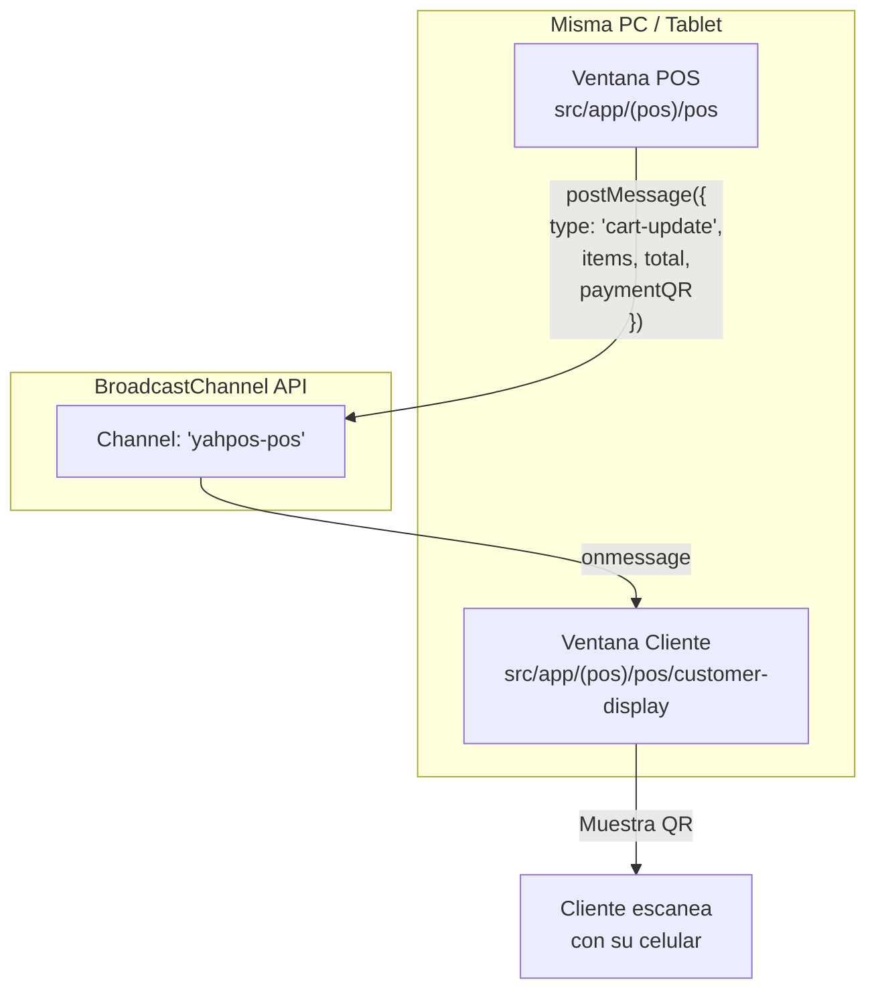

### Hook: `useCustomerDisplaySync`

```typescript
// src/lib/hooks/useCustomerDisplaySync.ts

// POS → Broadcast
function useCustomerDisplayBroadcast() {
  const bc = useRef(new BroadcastChannel('yahpos-pos'))
  
  const broadcast = (data: CustomerDisplayData) => {
    bc.current.postMessage(data)
  }

  // Llamar en cada cambio de carrito
  useEffect(() => {
    broadcast({
      type: 'cart-update',
      items: posStore.items,
      subtotal: posStore.subtotal,
      total: posStore.total,
      discount: posStore.discount,
      method: selectedMethod,
      qrData: paymentQR // cuando aplica
    })
  }, [posStore.items, posStore.total])
}

// Customer Display → Receive
function useCustomerDisplayReceiver() {
  const bc = new BroadcastChannel('yahpos-pos')
  const [data, setData] = useState<CustomerDisplayData | null>(null)

  useEffect(() => {
    bc.onmessage = (event) => setData(event.data)
    return () => bc.close()
  }, [])
}
```

---

## 3. Transbank Webpay Plus

### Estado Actual
✅ **E-commerce:** Integración completa (`tx.create()`, `tx.commit()`)
❌ **POS:** No integrado (solo animación placeholder)

### Lo que YA tenemos

| Recurso | Archivo | Estado |
|---------|---------|--------|
| SDK Transbank v6.1.1 | `package.json` | ✅ Instalado |
| Cliente configurado | `src/lib/payments/transbank.ts` | ✅ |
| API create transaction | `src/app/api/payments/webpay/create/route.ts` | ✅ |
| API commit transaction | `src/app/api/payments/webpay/commit/route.ts` | ✅ |
| `.env` vars | `TRANSBANK_COMMERCE_CODE`, `TRANSBANK_API_KEY` | ✅ |

### Integración POS con QR

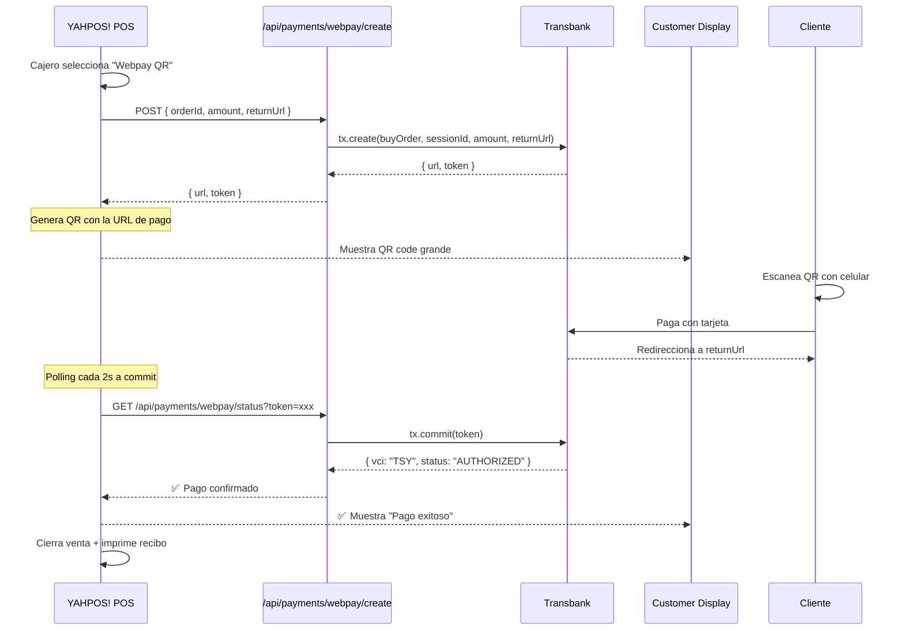

### Código Necesario

#### API Route: Verificar Estado (Polling)

```typescript
// src/app/api/payments/webpay/status/route.ts
import { NextResponse } from 'next/server'
import { tx } from '@/lib/payments/transbank'

export async function GET(req: Request) {
  const { searchParams } = new URL(req.url)
  const token = searchParams.get('token')
  
  if (!token) {
    return NextResponse.json({ error: 'Token requerido' }, { status: 400 })
  }

  try {
    const response = await tx.commit(token)
    
    if (response.vci === 'TSY' && response.status === 'AUTHORIZED') {
      return NextResponse.json({ 
        status: 'AUTHORIZED',
        authorizationCode: response.authorization_code,
        amount: response.amount
      })
    }

    if (response.status === 'REVERSED' || response.vci === 'TSN') {
      return NextResponse.json({ status: 'REJECTED' })
    }

    // INITIALIZED = el usuario aún no paga
    return NextResponse.json({ status: 'PENDING' })
  } catch (error: any) {
    // Token ya fue commiteado → buscar en DB
    return NextResponse.json({ 
      status: 'UNKNOWN',
      error: error.message 
    })
  }
}
```

### Para el Dueño del Negocio

| Configuración | Dónde | Descripción |
|--------------|-------|-------------|
| Activar Webpay QR | Admin → Configuración → Pagos | Habilita el botón "Webpay QR" en el POS |
| Código Comercio | `.env` → `TRANSBANK_COMMERCE_CODE` | Lo entrega Transbank al contratar |
| Llave Secreta | `.env` → `TRANSBANK_API_KEY` | Lo entrega Transbank al contratar |
| Ambiente | `.env` → `NODE_ENV` | `production` = real, `development` = pruebas |

### Costos Asociados

| Concepto | Costo |
|----------|-------|
| Comisión Transbank | ~1.5% - 2.5% + IVA (según plan) |
| Comisión por transacción | ~$30 - $100 CLP |
| Mantención | $0 (sin costo fijo mensual) |

---

## 4. Mercado Pago QR

### ¿Qué es?

Mercado Pago QR permite al cliente **escanear un código QR** con la app de Mercado Pago (o cualquier app bancaria chilena) y pagar al instante. El monto aparece automáticamente en su celular.

### Modalidad Recomendada: **Atendido (Attended Model)**

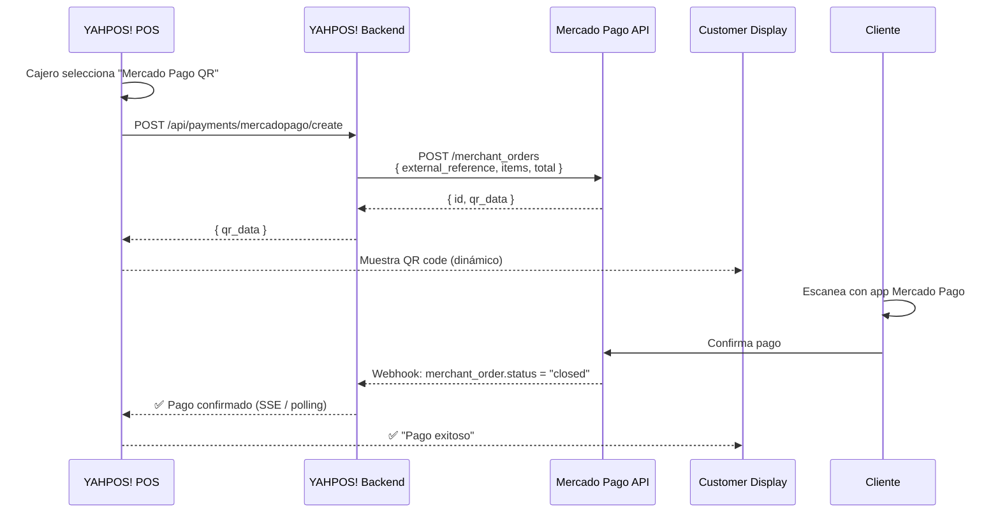

### API REST Reference

```
POST https://api.mercadopago.com/instore/orders/qr/seller/collectors/{user_id}/pos/{external_pos_id}/qrs
```

```json
{
  "external_reference": "ORD-20260514-1234",
  "title": "Compra en Tienda",
  "description": "Venta POS YAHPOS!",
  "items": [{
    "sku": "PROD-001",
    "title": "Coca Cola 1.5L",
    "quantity": 2,
    "unit_price": 2500
  }],
  "total_amount": 5000
}
```

### Modalidades

| Modalidad | Descripción | Cuándo usar |
|-----------|-------------|-------------|
| **QR Estático** | Mismo QR siempre. Cliente ingresa el monto manual. | Kioskos, ferias, monto variable |
| **QR Dinámico** | QR único por transacción. Monto pre-cargado. | POS atendido (recomendado) |
| **QR Híbrido** | QR estático + si el cliente escanea con la app de MP vinculada al negocio, ve el monto automático. | Lo mejor de ambos mundos |

### Para el Dueño del Negocio

| Configuración | Dónde | Descripción |
|--------------|-------|-------------|
| Activar MP QR | Admin → Configuración → Pagos | Habilita "Mercado Pago QR" en POS |
| Access Token | Admin → Credenciales | Se obtiene de la cuenta Mercado Pago |
| User ID | Admin → Credenciales | ID de la cuenta Mercado Pago |
| POS ID | Admin → Credenciales | ID del punto de venta en MP |

### Costos

| Concepto | Débito | Crédito |
|----------|--------|---------|
| Comisión QR | ~1.45% + IVA | ~2.75% + IVA |
| Sin mantención | ✅ | ✅ |
| Abono | Diario | Diario |

### Ventajas

- ✅ No requiere hardware adicional (solo el QR en pantalla)
- ✅ Clientes pagan con cualquier app bancaria chilena (no solo MP)
- ✅ Abono diario sin costo
- ✅ Sin contratos ni permanencia

---

## 5. SumUp Cloud API

### ¿Qué es?

SumUp ofrece un **lector Bluetooth** (SumUp Air) o un **Smart POS** (SumUp Solo) que se conecta vía Cloud API. Esto permite:

1. **SumUp Solo / Smart POS**: Terminal autónomo con chip 4G + WiFi. El POS le envía el monto vía API y el cliente paga en el terminal.
2. **SumUp Air**: Lector Bluetooth que se conecta al celular/tablet vía app.
3. **Cloud API**: Nuestro backend se comunica con la API de SumUp para crear checkouts y recibir webhooks.

### Arquitectura

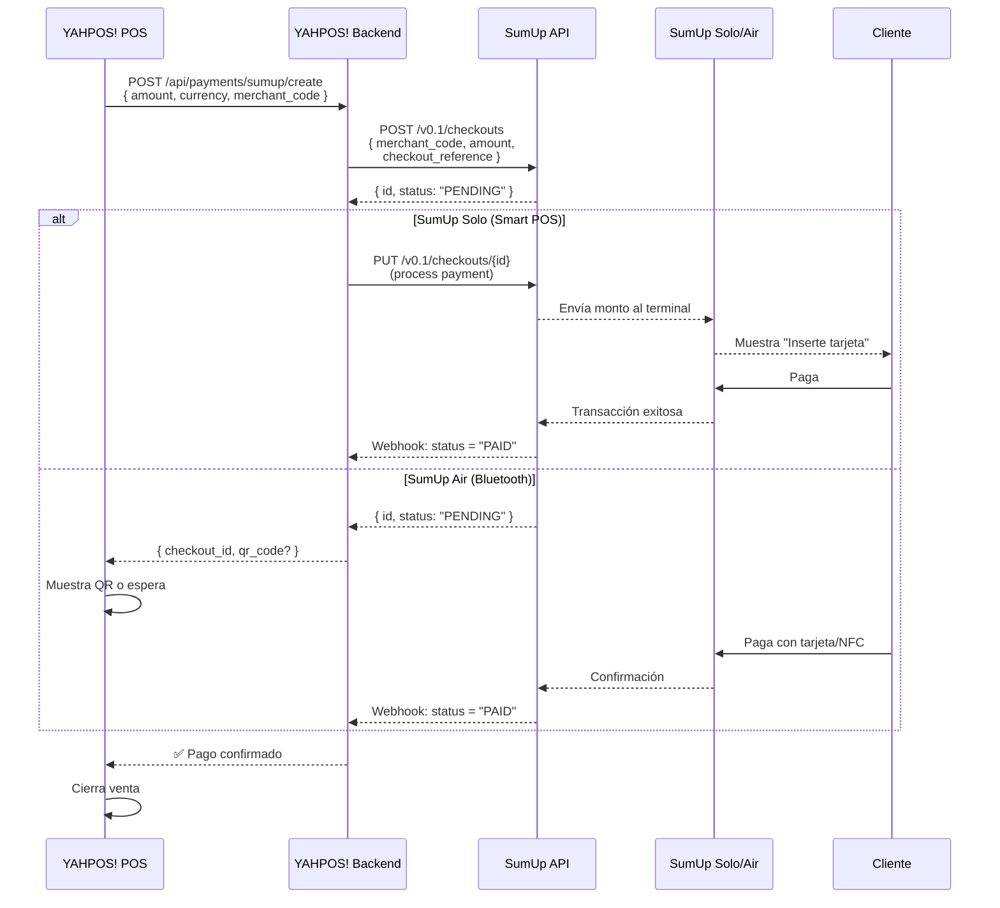

### Node.js SDK (Oficial)

```typescript
import { SumUp } from '@sumup/sdk'

const client = new SumUp({ 
  apiKey: process.env.SUMUP_API_KEY 
})

// 1. Listar lectores disponibles
const { items: readers } = await client.readers.list(merchantCode)

// 2. Crear checkout en un lector específico
const checkout = await client.readers.createCheckout(
  merchantCode, 
  readerId,
  {
    total_amount: {
      currency: 'CLP',
      minor_unit: 0,  // CLP no tiene decimales
      value: totalAmount
    }
  }
)

// 3. Recibir webhook cuando el pago se complete
// POST /api/payments/sumup/webhook
```

### Para el Dueño del Negocio

| Configuración | Dónde | Descripción |
|--------------|-------|-------------|
| Activar SumUp | Admin → Configuración → Pagos | Habilita "SumUp" en POS |
| API Key | `.env` → `SUMUP_API_KEY` | Del dashboard SumUp |
| Merchant Code | `.env` → `SUMUP_MERCHANT_CODE` | Código de comercio SumUp |
| Proceso | Comprar lector SumUp → Configurar API → YAHPOS! envía montos automáticos |

### Costos

| Concepto | Valor |
|----------|-------|
| Lector SumUp Air | ~$34.900 (compra única) |
| Lector SumUp Solo | ~$59.900 (compra única) |
| Comisión por transacción | 2.9% + IVA |
| Sin mensualidad | ✅ |
| Abono | Cada 1 hora o diario |

---

## 6. Flow

### Estado Actual

```typescript
// src/lib/flow.ts — ACTUALMENTE ES UN MOCK
export async function createFlowPayment(data: FlowPaymentRequest): Promise<FlowPaymentResponse> {
  // Simulación: retorna URL de sandbox
  return new Promise((resolve) => {
    setTimeout(() => {
      resolve({
        url: 'https://sandbox.flow.cl/app/web/pay.php',
        token: `mock_flow_token_${Date.now()}`,
        flowOrder: Math.floor(Math.random() * 1000000)
      })
    }, 500)
  })
}
```

### Integración Real con Flow API

Flow usa **HMAC-SHA256** para firmar todos los parámetros. No hay SDK oficial para Node.js, pero la API REST es sencilla.

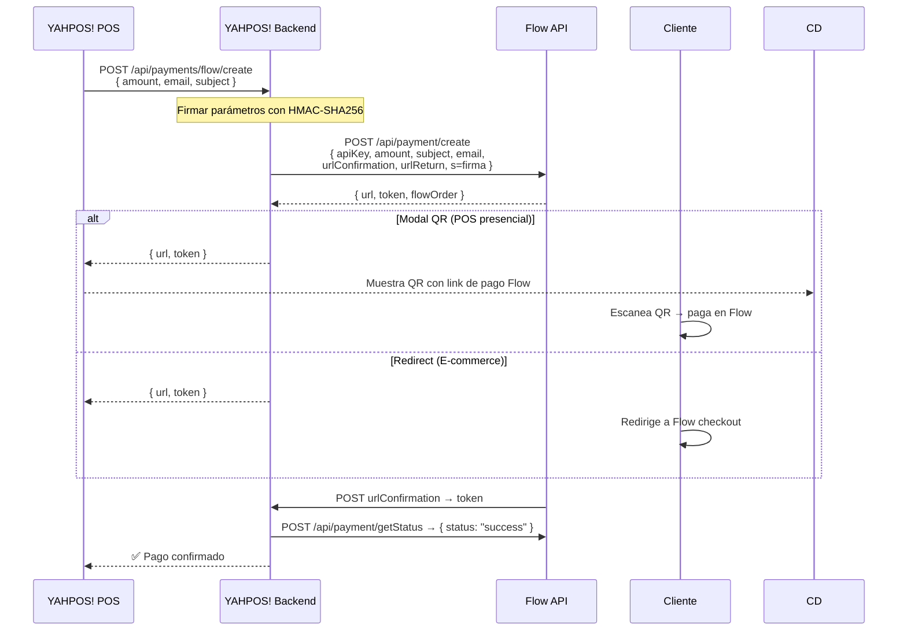

### Código Necesario

```typescript
// src/lib/payments/flow.ts — Reemplazar mock actual
import crypto from 'node:crypto'

const FLOW_API_URL = process.env.FLOW_SANDBOX === 'true'
  ? 'https://sandbox.flow.cl/api'
  : 'https://www.flow.cl/api'

interface FlowParams {
  apiKey: string
  commerceOrder: string
  subject: string
  amount: number
  email: string
  urlConfirmation: string
  urlReturn: string
  paymentMethod?: number  // 1=crédito, 2=débito, 9=cuotas
  currency?: string
}

function signParams(params: Record<string, any>, secretKey: string): string {
  const keys = Object.keys(params).sort()
  const toSign = keys.map(k => `${k}${params[k]}`).join('')
  return crypto.createHmac('sha256', secretKey).update(toSign).digest('hex')
}

export async function createFlowPayment(data: FlowParams) {
  const secretKey = process.env.FLOW_SECRET_KEY!
  const params = {
    apiKey: process.env.FLOW_API_KEY!,
    commerceOrder: data.commerceOrder,
    subject: data.subject,
    amount: data.amount,
    email: data.email,
    urlConfirmation: data.urlConfirmation,
    urlReturn: data.urlReturn,
    ...(data.paymentMethod && { paymentMethod: data.paymentMethod })
  }

  const signature = signParams(params, secretKey)

  const response = await fetch(`${FLOW_API_URL}/payment/create`, {
    method: 'POST',
    headers: { 'Content-Type': 'application/x-www-form-urlencoded' },
    body: new URLSearchParams({ ...params, s: signature })
  })

  return response.json()
}

export async function getFlowPaymentStatus(token: string) {
  const params = {
    apiKey: process.env.FLOW_API_KEY!,
    token
  }
  const signature = signParams(params, process.env.FLOW_SECRET_KEY!)
  
  const response = await fetch(`${FLOW_API_URL}/payment/getStatus`, {
    method: 'POST',
    headers: { 'Content-Type': 'application/x-www-form-urlencoded' },
    body: new URLSearchParams({ ...params, s: signature })
  })

  return response.json()
}
```

### Medios de Pago Flow

| ID | Medio de Pago | Descripción |
|----|--------------|-------------|
| 1 | **Crédito** | Tarjetas de crédito (Visa, MC, Amex) |
| 2 | **Débito** | Redcompra, BancoEstado |
| 5 | **Cuotas sin interés** | Hasta 12 cuotas |
| 6 | **Cuotas con interés** | Hasta 48 cuotas |
| 9 | **Prepago** | Tarjetas prepago |
| Sin ID | Todos | Flow muestra selección de medios |

### Para el Dueño del Negocio

| Configuración | Dónde | Descripción |
|--------------|-------|-------------|
| Activar Flow | Admin → Configuración → Pagos | Habilita "Flow" en POS y E-commerce |
| API Key | Admin → Credenciales | Del dashboard Flow |
| Secret Key | Admin → Credenciales | Del dashboard Flow |
| Sandbox | Admin → Configuración | Activar modo pruebas |
| Medios activos | Portal Flow | Configurar qué medios de pago mostrar |

### Costos

| Concepto | Débito | Crédito | Cuotas |
|----------|--------|---------|--------|
| Comisión | ~1.5% + IVA | ~2.0% + IVA | ~2.5% + IVA |
| Sin mantención | ✅ | ✅ | ✅ |

---

## 7. Getnet POS Integrado

### ¿Qué es?

Getnet (Santander) ofrece **POS Integrado**: el terminal físico se comunica directamente con nuestro sistema **sin que el cajero tenga que digitar montos**. Esto elimina errores de tipeo.

### Modalidades de Conexión

| Modalidad | Cómo funciona | Recomendado |
|-----------|---------------|-------------|
| **HTTP (Wi-Fi/Ethernet)** | El terminal y el POS están en la misma red. Nuestro backend envía comandos HTTP al terminal. | ✅ Para tiendas fijas |
| **USB/Serial** | Conexión física por cable USB. Similar a como conectamos la impresora térmica. | ⚠️ Si no hay WiFi |
| **Cloud-to-Cloud** | El terminal se conecta a la nube de Getnet. Nuestro backend se comunica con la API de Getnet en la nube. | ✅ Para sucursales distribuidas |

### Arquitectura Cloud-to-Cloud (Recomendada)

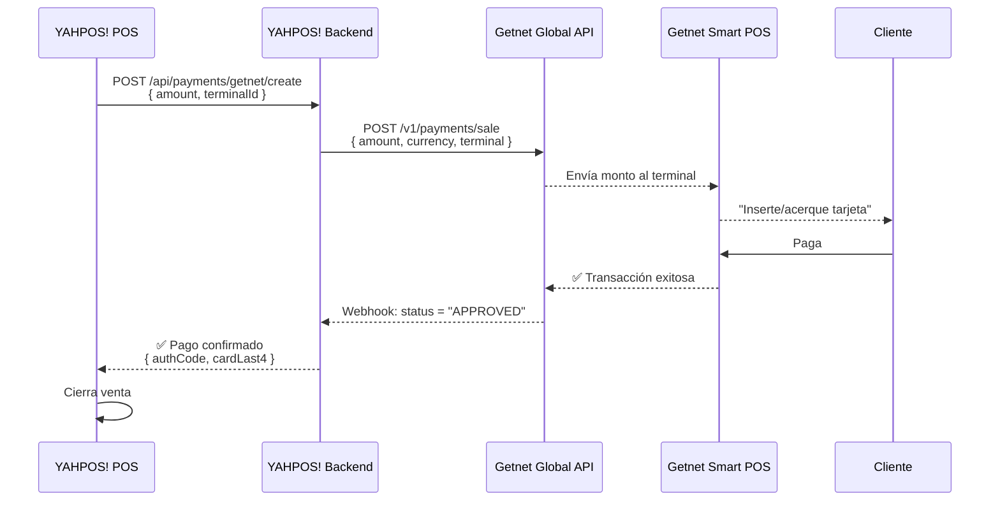

### Código Referencia

```typescript
// src/lib/payments/getnet.ts
const GETNET_API = 'https://api.globalgetnet.com/v1'

interface SaleRequest {
  amount: number
  currency: 'CLP'
  terminal_id: string
  reference: string
  installments?: number
}

export async function createGetnetSale(data: SaleRequest) {
  const response = await fetch(`${GETNET_API}/payments/sale`, {
    method: 'POST',
    headers: {
      'Authorization': `Bearer ${process.env.GETNET_API_KEY}`,
      'Content-Type': 'application/json'
    },
    body: JSON.stringify({
      amount: data.amount,
      currency: data.currency,
      terminal: data.terminal_id,
      merchant_reference: data.reference,
      installments: data.installments || 1,
      capture: true
    })
  })

  return response.json()
}

export async function checkGetnetStatus(reference: string) {
  const response = await fetch(
    `${GETNET_API}/payments/status?merchant_reference=${reference}`,
    { headers: { 'Authorization': `Bearer ${process.env.GETNET_API_KEY}` } }
  )
  return response.json()
}
```

### Para el Dueño del Negocio

| Configuración | Dónde | Descripción |
|--------------|-------|-------------|
| Activar Getnet | Admin → Configuración → Pagos | Habilita "Getnet POS" en POS |
| API Key | `.env` → `GETNET_API_KEY` | Del portal Getnet Developers |
| Terminal ID | Admin → Configuración → Terminales | ID del terminal Getnet |
| Contrato | Getnet | Contratar POS Integrado con Santander |

### Costos

| Concepto | Valor |
|----------|-------|
| Terminal Smart POS | Incluido en el plan Getnet |
| Comisión débito | ~1.2% + IVA |
| Comisión crédito | ~1.8% + IVA |
| Sin mantención | ✅ (según plan) |

---

## 8. TUU Pago Remoto

### ¿Qué es?

TUU (ex-ComprAquí, Haulmer) ofrece **Pago Remoto**: el terminal físico TUU recibe el monto automáticamente desde nuestro sistema. El cajero no digita nada.

### Arquitectura

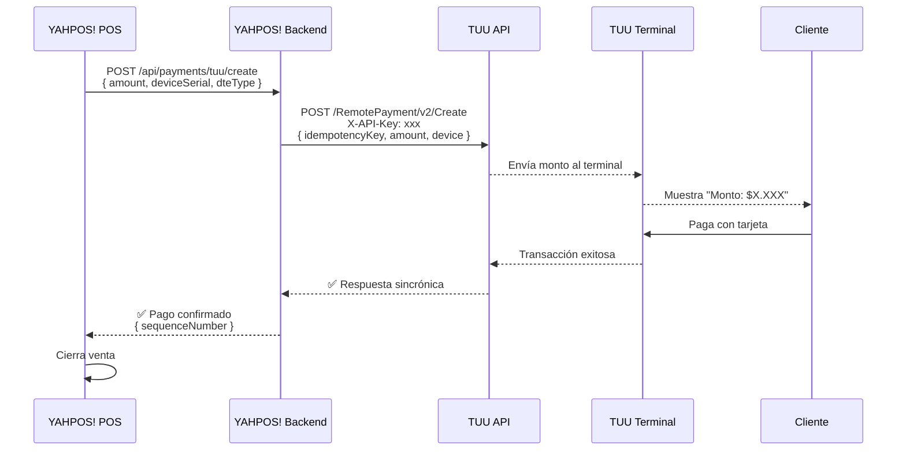

### API Reference

```
POST https://integrations.payment.haulmer.com/RemotePayment/v2/Create
Header: X-API-Key: {apiKey}
```

```json
{
  "idempotencyKey": "VENTA-20260514-001",
  "amount": 15000,
  "device": "TJ44245N20440",
  "cashbackAmount": 0,
  "tipAmount": 0,
  "paymentMethod": 1,
  "description": "Venta POS YAHPOS!",
  "dteType": 39
}
```

| Campo | Tipo | Descripción |
|-------|------|-------------|
| `idempotencyKey` | string | Identificador único (evita duplicados) |
| `amount` | int | Monto total (en CLP, sin decimales) |
| `device` | string | Número de serie del terminal TUU |
| `paymentMethod` | int | 1=crédito, 2=débito |
| `dteType` | int | Tipo DTE (39=boleta, 33=factura, 0=no DTE) |

### Request V2 (con idempotencia)

```typescript
export async function createTuuPayment(data: {
  idempotencyKey: string
  amount: number
  device: string
  paymentMethod: 1 | 2
  dteType?: number
}) {
  const response = await fetch(
    'https://integrations.payment.haulmer.com/RemotePayment/v2/Create',
    {
      method: 'POST',
      headers: {
        'X-API-Key': process.env.TUU_API_KEY!,
        'Content-Type': 'application/json'
      },
      body: JSON.stringify({
        idempotencyKey: data.idempotencyKey,
        amount: data.amount,
        device: data.device,
        cashbackAmount: 0,
        tipAmount: 0,
        paymentMethod: data.paymentMethod,
        description: 'YAHPOS! Venta POS',
        dteType: data.dteType || 39
      })
    }
  )

  return response.json()
}
```

### Para el Dueño del Negocio

| Configuración | Dónde | Descripción |
|--------------|-------|-------------|
| Activar TUU | Admin → Configuración → Pagos | Habilita "TUU" en POS |
| API Key | `.env` → `TUU_API_KEY` | Del Espacio de Trabajo TUU |
| Serial Device | Admin → Configuración → Terminales | N° de serie del terminal TUU |
| Activar terminal | En el POS TUU físico | Menú → "Modo Integración" |

### Costos

| Concepto | Valor |
|----------|-------|
| Terminal TUU | Incluido al contratar |
| Comisión débito | ~1.0% + IVA |
| Comisión crédito | ~1.5% + IVA |
| Mantención mensual | ~$5.000 - $15.000 CLP |

---

## 9. Matriz de Medios de Pago

### POS (Presencial)

| Método | Tipo | Hardware Necesario | SDK/API | Esfuerzo | Prioridad |
|--------|------|--------------------|---------|----------|-----------|
| **Efectivo** | Manual | Ninguno | — | ✅ Ya funciona | — |
| **Webpay QR** | QR en pantalla | Ninguno (solo display) | `transbank-sdk` ✅ existe | 🟢 Bajo | 🔥 Alta |
| **Mercado Pago QR** | QR en pantalla | Ninguno (solo display) | API REST | 🟡 Medio | 🔥 Alta |
| **SumUp Air** | Bluetooth | Lector SumUp Air (~$35K) | `@sumup/sdk` | 🔴 Alto | 🔥 Media |
| **SumUp Solo** | Smart POS | Terminal SumUp Solo (~$60K) | `@sumup/sdk` | 🟡 Medio | 🔥 Media |
| **Flow** | Link / Cuotas | Ninguno | API REST (HMAC) | 🟢 Bajo | 🔥 Alta |
| **Getnet POS** | Terminal sincro | Smart POS Getnet | Global API REST | 🟡 Medio | 🔥 Media |
| **TUU Pago Remoto** | Terminal sincro | Terminal TUU | API REST | 🟢 Bajo | 🔥 Media |
| **Tarjeta (manual)** | Registro manual | Terminal externo cualquiera | — | ✅ Ya funciona placeholder | — |

### E-commerce (Online)

| Método | Estado | SDK/API |
|--------|--------|---------|
| **Webpay Plus** | ✅ **Completo** | `transbank-sdk` |
| **Flow** | ❌ **Mock** → Reemplazar por API real | API REST (HMAC) |
| **Transferencia** | 🟡 Pendiente UI | Manual |
| **Efectivo contra entrega** | 🟡 Pendiente UI | Manual |

---

## 10. Configuración por Negocio

### Admin Panel → Configuración → Pagos

Cada dueño de negocio puede **activar/desactivar** cada método de pago independientemente:

```
┌──────────────────────────────────────────────┐
│  💳 Medios de Pago — POS                     │
│                                              │
│  ┌─────────────────────────────────────────┐ │
│  │  ☑ Efectivo                  [ Siempre ] │ │
│  │  ☑ Webpay QR              [ Activo  🔵 ] │ │
│  │  ☑ Mercado Pago QR         [ Activo  🔵 ] │ │
│  │  ☑ SumUp (Bluetooth)       [ Inactivo ⚪ ] │ │
│  │  ☑ Flow (Cuotas)           [ Activo  🔵 ] │ │
│  │  ☑ Getnet POS Integrado    [ Inactivo ⚪ ] │ │
│  │  ☑ TUU Pago Remoto         [ Inactivo ⚪ ] │ │
│  │  ☑ Terminal (manual)       [ Activo  🔵 ] │ │
│  └─────────────────────────────────────────┘ │
│                                              │
│  💳 Medios de Pago — E-commerce              │
│                                              │
│  ┌─────────────────────────────────────────┐ │
│  │  ☑ Webpay Plus            [ Activo  🔵 ] │ │
│  │  ☑ Flow                   [ Activo  🔵 ] │ │
│  │  ☑ Transferencia          [ Activo  🔵 ] │ │
│  │  ☑ Efectivo contra entrega [ Inactivo ⚪ ] │ │
│  └─────────────────────────────────────────┘ │
└──────────────────────────────────────────────┘
```

### Modelo de Datos

```typescript
// En posStore.settings.activeTerminals
interface ActiveTerminals {
  cash: boolean        // Efectivo
  transbank: boolean   // Webpay QR
  mercadopago: boolean // MP QR
  sumup: boolean       // SumUp BT
  flow: boolean        // Flow
  getnet: boolean      // Getnet POS
  tuu: boolean         // TUU
  other_card: boolean  // Terminal manual
}
```

---

## 11. Plan de Implementación

### Fase 0 — Fix IVA Duplication + Lógica SII por Terminal (Ahora, previo)
**Duración estimada:** 1 día

| # | Tarea | Archivos | Dependencias |
|---|-------|----------|-------------|
| 0.1 | Clasificar terminales que emiten DTE vs pasarelas | `src/lib/hardware/types.ts` + constante `TERMINALS_WITH_DTE` | — |
| 0.2 | Corregir `shouldSkipSii` en `handleCheckout` | `src/app/(pos)/pos/page.tsx` (línea 658-660) | 0.1 |
| 0.3 | Wirear `getnetIsBoleta` field existente | `src/app/(pos)/pos/page.tsx` | 0.2 |
| 0.4 | Validación de seguridad anti-dualidad | `src/app/(pos)/pos/page.tsx` | 0.2 |
| 0.5 | Actualizar `PosSettingsModal` para configuración por terminal | `src/components/pos/PosSettingsModal.tsx` | 0.1 |

### Fase 1 — Customer Display + Webpay QR (Ahora)
**Duración estimada:** 2-3 días

| # | Tarea | Archivos | Dependencias |
|---|-------|----------|-------------|
| 1.1 | Hook `useCustomerDisplaySync` (BroadcastChannel) | `src/lib/hooks/useCustomerDisplaySync.ts` | — |
| 1.2 | Customer Display page (UI fullscreen) | `src/app/(pos)/pos/customer-display/page.tsx` | 1.1 |
| 1.3 | Broadcast carrito desde POS + QR data | `src/app/(pos)/pos/page.tsx` | 1.1 |
| 1.4 | Webpay QR en POS (reusar SDK existente) | `src/app/api/payments/webpay/status/route.ts` + `PaymentModal.tsx` | 0.0 |
| 1.5 | QR en Customer Display | `src/app/(pos)/pos/customer-display/page.tsx` | 1.2 + 1.4 |

### Fase 2 — Mercado Pago QR + Flow Real (Siguiente)
**Duración estimada:** 2-3 días

| # | Tarea | Archivos | Dependencias |
|---|-------|----------|-------------|
| 2.1 | Integración Mercado Pago API + QR | `src/lib/payments/mercadopago.ts` + API route | — |
| 2.2 | Reemplazar Flow mock por API real | `src/lib/payments/flow.ts` + API route | — |
| 2.3 | UI PaymentModal: MP QR + Flow cuotas | `src/components/pos/PaymentModal.tsx` | 2.1 + 2.2 |

### Fase 3 — Terminales Físicos (Futuro)
**Duración estimada:** 2-3 días cada uno

| # | Tarea | Dependencias |
|---|-------|-------------|
| 3.1 | Integración SumUp Cloud API + lector BT | Contar con lector SumUp |
| 3.2 | Integración Getnet POS (Cloud-to-Cloud) | Contrato Getnet POS Integrado |
| 3.3 | Integración TUU Pago Remoto | Terminal TUU + API Key |

### Fase 4 — E-commerce (Mantención)
| # | Tarea | Prioridad |
|---|-------|-----------|
| 4.1 | Reemplazar Flow mock en checkout | 🔥 Alta (depende de Fase 2.2) |

---

## 12. Control de Duplicación de IVA (SII Compliance)

### ⚠️ El Problema

En Chile, **cada venta debe tener UN solo documento tributario**. Si el terminal de pago emite una boleta y el POS también emite otra por la misma venta, el SII recibe dos declaraciones de IVA para una misma transacción, lo que constituye **una infracción grave** con multas asociadas.

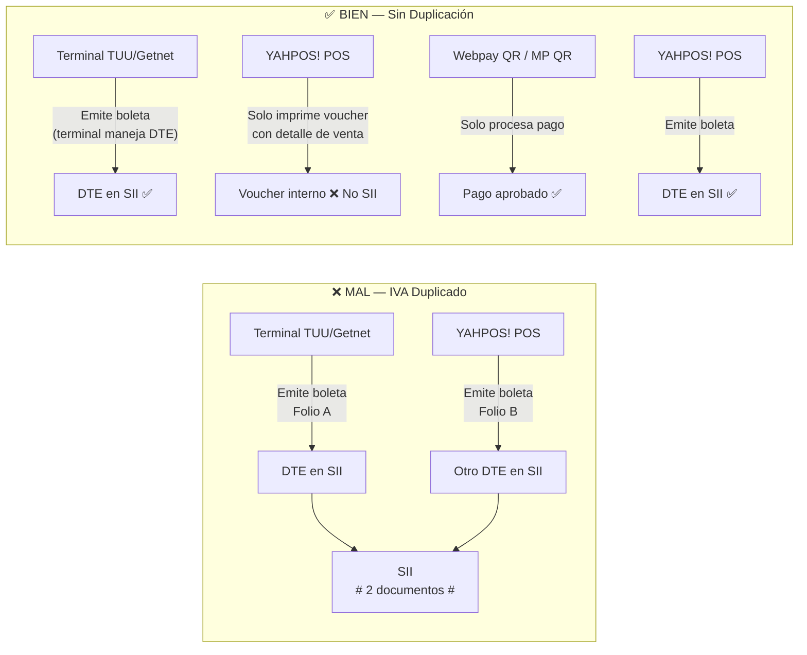

### Clasificación de Métodos de Pago

| Grupo | Métodos | ¿Maneja su propio DTE? | Acción del POS |
|-------|---------|------------------------|----------------|
| **Pasarela de pago** | Webpay QR, Mercado Pago QR, Flow Link, Transferencia | ❌ No — solo procesan el pago | ✅ POS emite boleta electrónica normal |
| **Terminal con DTE** | TUU (dteType en API), Getnet Smart POS, SumUp Solo (conexión SII) | ✅ Sí — el terminal emite boleta fiscal | ❌ POS salta SII, solo imprime voucher comercial |
| **Manual** | Efectivo, Tarjeta (terminal externo cualquiera), Otro | ❌ No — no hay sistema conectado | ✅ POS emite boleta electrónica normal |
| **Voucher** | JUNAEB, Pluxe, Edenred | N/A — son exentos de IVA | ❌ POS salta SII, solo imprime voucher |

### Lógica de Decisión SII (Propuesta Corregida)

```typescript
// src/app/(pos)/pos/page.tsx — handleCheckout()

// Terminales que emiten su propio DTE (boleta fiscal)
const TERMINALS_WITH_DTE: Record<string, boolean> = {
  'TUU': true,        // API tiene campo dteType
  'Getnet': true,     // Smart POS emite boleta
  'SumUp Solo': true, // Conexión SII integrada
  // 'SumUp Air': false, // Solo lector BT, no emite DTE
}

// Pasarelas de pago (NO emiten DTE, solo procesan el pago)
const GATEWAY_METHODS = ['WEBPAY_QR', 'MERCADOPAGO_QR', 'FLOW']
const VOUCHER_METHODS = ['JUNAEB', 'PLUXE', 'EDENRED']

const isVoucher = VOUCHER_METHODS.includes(paymentMethod)
const isGateway = GATEWAY_METHODS.includes(paymentMethod)
const terminalHandlesDte = paymentMethod === 'TERMINAL' 
  && TERMINALS_WITH_DTE[terminalType] === true

// Decisión final:
const shouldSkipSii = 
  isVoucher                        // ✅ Exentos de IVA
  || terminalHandlesDte            // ✅ Terminal ya emitió boleta
  || (settings.siiModel === 'SII_VOUCHER_SKIP' && isGateway) // ✅ Opcional: salta para QR (dueño decide)
```

### Matriz de Comportamiento por Método

| Método de Pago      | POS ¿Emite Boleta SII? |  POS ¿Imprime Voucher?  |      Documento Legal       |
| ------------------- | :--------------------: | :---------------------: | :------------------------: |
| **Efectivo**        |     ✅ Sí (DTE 39)      |  ✅ Recibo con detalle   | Boleta Electrónica YAHPOS! |
| **Webpay QR**       |     ✅ Sí (DTE 39)      |  ✅ Voucher + QR pagado  | Boleta Electrónica YAHPOS! |
| **Mercado Pago QR** |     ✅ Sí (DTE 39)      |  ✅ Voucher + QR pagado  | Boleta Electrónica YAHPOS! |
| **Flow**            |     ✅ Sí (DTE 39)      | ✅ Voucher + link pagado | Boleta Electrónica YAHPOS! |
| **TUU**             |      ❌ No (salta)      |    ✅ Voucher interno    |   Boleta Electrónica TUU   |
| **Getnet**          |      ❌ No (salta)      |    ✅ Voucher interno    | Boleta Electrónica Getnet  |
| **SumUp Solo**      |      ❌ No (salta)      |    ✅ Voucher interno    |  Boleta Electrónica SumUp  |
| **SumUp Air**       |     ✅ Sí (DTE 39)      |   ✅ Voucher + pago BT   | Boleta Electrónica YAHPOS! |
| **JUNAEB**          |     ❌ No (exento)      |    ✅ Voucher sellos     |    Comprobante interno     |
| **Pluxe**           |     ❌ No (exento)      |    ✅ Voucher sellos     |    Comprobante interno     |
| **Edenred**         |     ❌ No (exento)      |    ✅ Voucher sellos     |    Comprobante interno     |

### Voucher vs Boleta — Diferencias en el Recibo

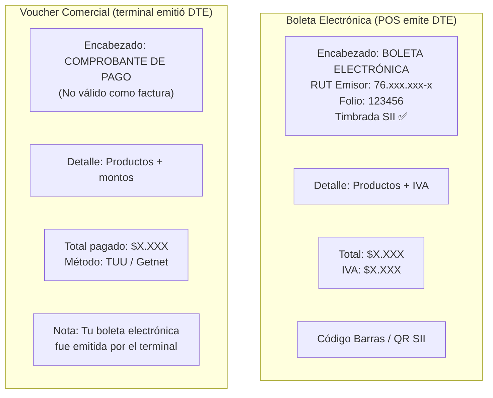

### Configuración por Terminal en Admin

Cada terminal tiene su propio toggle **"Este terminal emite boleta"**:

```
┌──────────────────────────────────────────────┐
│  ⚙️ Terminales Físicos                       │
│                                              │
│  ┌─────────────────────────────────────────┐ │
│  │  TUU - T-J44245N20440                   │ │
│  │  ☑ Este terminal emite su propia boleta │ │
│  │  Última conexión: 14/05 15:30           │ │
│  ├─────────────────────────────────────────┤ │
│  │  Getnet - POS-001                       │ │
│  │  ☑ Este terminal emite su propia boleta │ │
│  │  Última conexión: 14/05 15:28           │ │
│  └─────────────────────────────────────────┘ │
└──────────────────────────────────────────────┘
```

### Validación Contra Dualidad (Seguridad)

Para prevenir errores de configuración, se implementa una validación al momento del pago:

```typescript
function validateSiiEmission(paymentMethod: string, terminalType: string, skipSii: boolean) {
  // Si el terminal tiene dteType=39 en su API y NO estamos saltando SII → ALERTA
  const terminalNeedsSkip = TERMINALS_WITH_DTE[terminalType]
  if (terminalNeedsSkip && !skipSii) {
    console.error(`[SII SAFETY] Terminal ${terminalType} emite DTE pero POS no salta SII`)
    toast.error('Configuración inválida: el terminal ya emite boleta. Activa "Saltar SII".')
    return false // Bloquea el pago
  }
  return true
}
```

---

## 13. Flujo Completo de E-commerce

### Estado Actual

```mermaid
flowchart LR
    subgraph "E-commerce Checkout"
        CART[Carrito Web]
        CHECKOUT[Paso 1: Datos<br/>Paso 2: Pago<br/>Paso 3: Confirmar]
        CREATE[/api/orders<br/>status: pending]
        WEBPAY[/api/payments/webpay/create]
        COMMIT[/api/payments/webpay/commit]
        FLOW_MOCK["src/lib/flow.ts<br/>❌ Mock"]
    end

    subgraph "SII"
        NO_SII["❌ No genera<br/>documentos tributarios"]
    end

    CART --> CHECKOUT
    CHECKOUT -->|"Webpay"| WEBPAY
    CHECKOUT -->|"Flow"| FLOW_MOCK
    CHECKOUT -->|"Transferencia"| CREATE
    
    WEBPAY -->|"tx.create()"| TBK[Transbank]
    TBK -->|"redirect + token_ws"| COMMIT
    COMMIT -->|"status: PAID"| CREATE
    
    CREATE -.->|"⚠️ Sin integración"| NO_SII
```

### Diferencias POS vs E-commerce

| Aspecto | POS (Presencial) | E-commerce (Online) |
|---------|:----------------:|:-------------------:|
| Store | `usePosStore` | `useCartStore` |
| Items | `PosItem[]` (product + qty) | `CartItem[]` (product + qty) |
| Cliente | `customerRut` opcional | Formulario completo (nombre, email, dirección, RUT) |
| Estado inicial | `status: 'completed'` | `status: 'pending'` |
| Pago | `payment_status: 'paid'` | `payment_status: 'pending'` |
| SII | Motor DTE completo (cola, folios, TED, CAF) | ❌ **No emite documentos** |
| Cash Session | Apertura/cierre de caja | No aplica |
| Loyalty puntos | ✅ Gana + **canjea** | ✅ Solo gana (❌ no canjea) |
| Cuotas | ❌ No soportado | ❌ No soportado |
| Offline | ✅ Cola offline + sync manager | ❌ Requiere conexión |

### Flujo Detallado del Checkout E-commerce

```mermaid
sequenceDiagram
    participant U as Usuario
    participant FE as Frontend (checkout/page.tsx)
    participant API as Backend (Next.js)
    participant TBK as Transbank
    participant DB as Supabase

    U->>FE: Llena datos de envío
    U->>FE: Selecciona "Webpay Plus"
    FE->>FE: Valida formulario
    
    FE->>API: POST /api/orders { items, total, customer, source: 'ecommerce' }
    API->>DB: INSERT orders { status: 'pending', payment_status: 'pending' }
    DB-->>API: { id: 123 }
    API-->>FE: { id: 123 }
    
    FE->>API: POST /api/payments/webpay/create { orderId: 123, amount, returnUrl }
    API->>TBK: tx.create(buyOrder, sessionId, amount, returnUrl)
    TBK-->>API: { url, token }
    API-->>FE: { url, token }
    
    FE->>FE: Redirige a url + token_ws
    U->>TBK: Paga en formulario Transbank
    TBK->>FE: Redirect a /flow-confirmation?token_ws=xxx
    
    FE->>API: POST /api/payments/webpay/commit { token_ws }
    API->>TBK: tx.commit(token_ws)
    TBK-->>API: { vci: 'TSY', status: 'AUTHORIZED' }
    API->>DB: UPDATE orders { status: 'PAID', payment_status: 'paid' }
    API-->>FE: { success: true, authorizationCode, amount }
    
    FE->>U: ✅ Muestra confirmación
    FE->>DB: UPDATE loyalty_points (+ganados)
```

### Flujo Actual vs Propuesto para SII en E-commerce

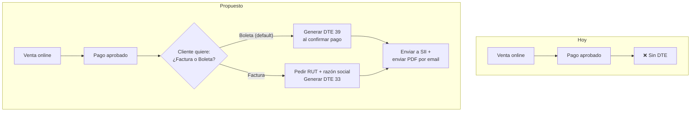

### Configuración de SII para E-commerce (Admin Propuesto)

```
┌──────────────────────────────────────────────┐
│  🧾 SII — E-commerce                         │
│                                              │
│  ┌─────────────────────────────────────────┐ │
│  │  Emisión automática al pagar:           │ │
│  │  ○ Siempre Boleta (DTE 39)              │ │
│  │  ○ Preguntar cliente (Boleta/Factura)   │ │
│  │  ○ No emitir (solo comprobante)         │ │
│  └─────────────────────────────────────────┘ │
│                                              │
│  ┌─────────────────────────────────────────┐ │
│  │  ☑ Enviar PDF por email al cliente      │ │
│  │  ☑ Mostrar QR de SII en página éxito    │ │
│  └─────────────────────────────────────────┘ │
└──────────────────────────────────────────────┘
```

### Gaps Identificados y Soluciones

| # | Gap | Impacto | Solución Propuesta |
|---|-----|---------|------------------|
| 1 | **Flow es mock** | Pagos Flow no se registran realmente | Reemplazar con API real HMAC-SHA256 |
| 2 | **Sin SII en e-commerce** | Ventas online sin documento tributario | Integrar `siiStore` en e-commerce + generar DTE post-pago |
| 3 | **Sin cuotas/installments** | No se puede vender en cuotas online | Webpay Plus Mall Installments + Flow cuotas |
| 4 | **Sin canje de puntos online** | Clientes no pueden usar puntos acumulados en web | Agregar UI de canje en checkout + integrar con `/api/orders` |
| 5 | **Transferencia sin confirmación** | No hay forma de verificar pago por transferencia | Panel admin para "confirmar pago manual" + webhook |
| 6 | **getnetIsBoleta no cableado** | Configuración existe pero no se usa | Wirear en lógica `shouldSkipSii` |
| 7 | **TUU descrito como "boleta en equipo"** | Descripción en UI sugiere integración que no existe | Actualizar descripción o implementar skip automático para TUU |

### Plan para E-commerce (Fase 4 Extendida)

| #   | Tarea                                 | Esfuerzo | Dependencia         |
| --- | ------------------------------------- | -------- | ------------------- |
| 4.1 | Flow API real                         | 🟢 Bajo  | —                   |
| 4.2 | SII en e-commerce (boleta post-pago)  | 🔴 Alto  | Motor SII existente |
| 4.3 | Cuotas Webpay Mall Installments       | 🟡 Medio | Contrato Transbank  |
| 4.4 | Canje de puntos en checkout web       | 🟡 Medio | Store de loyalty    |
| 4.5 | Confirmación manual de transferencias | 🟢 Bajo  | Panel admin         |

---

| Proveedor | Documentación |
|-----------|--------------|
| Transbank Developers | https://transbankdevelopers.cl |
| Mercado Pago QR | https://www.mercadopago.cl/developers/en/docs/qr-code/overview |
| SumUp Developer | https://developer.sumup.com |
| Flow API | https://www.flow.cl/docs/api.html |
| Getnet Docs | https://docs.globalgetnet.com |
| TUU Developers | https://developers.tuu.cl/docs |

---

> **Documento generado:** 2026-05-14
> **Próxima revisión:** Cuando se implemente cada fase
