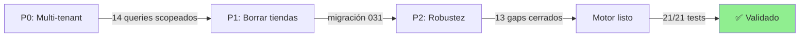
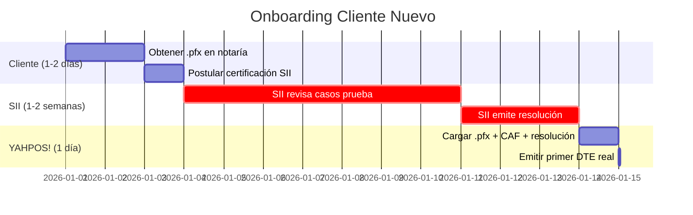
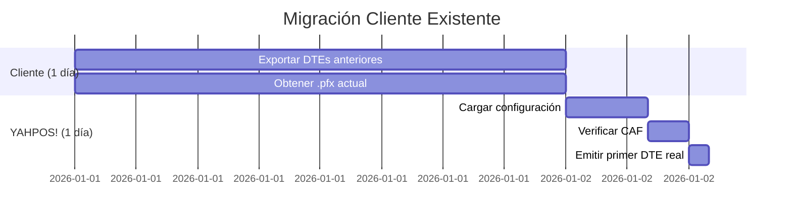
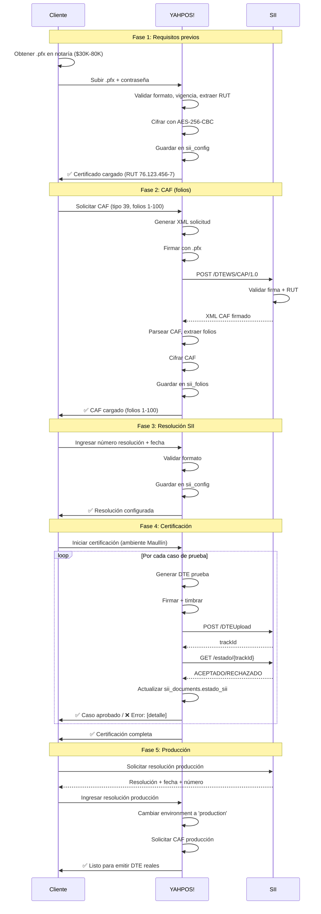
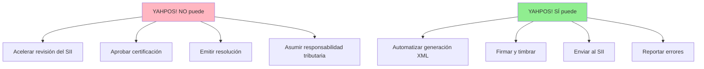
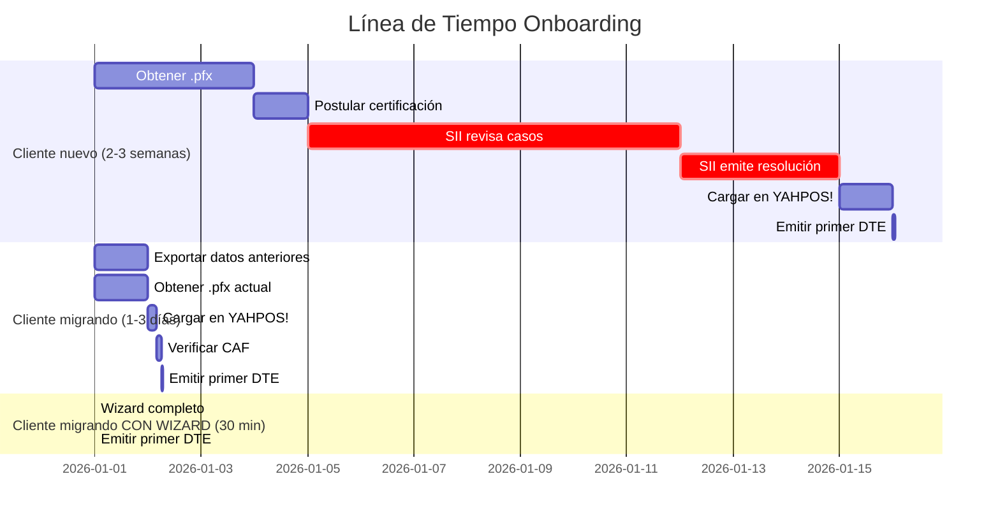
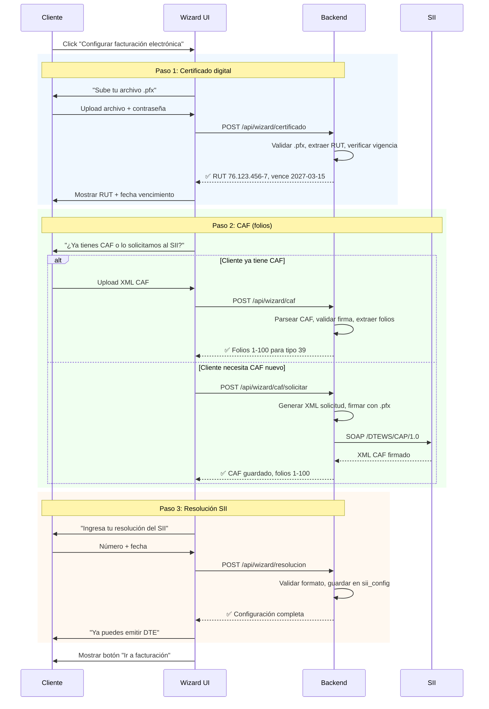
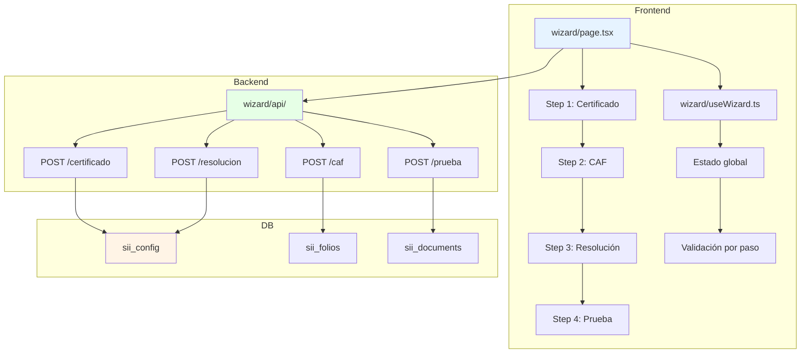

# Onboarding DTE - Guía Completa

**Creado:** 2026-11-13  
**Estado:** Planificación  
**Implementación:** Wizard pendiente (estimado: 2-3 días)

---

## Tabla de Contenidos

1. [Estado Actual del Motor DTE](#1-estado-actual-del-motor-dte)
2. [Flujo de Onboarding de Clientes](#2-flujo-de-onboarding-de-clientes)
3. [Responsabilidades](#3-responsabilidades)
4. [Tiempos Estimados](#4-tiempos-estimados)
5. [Wizard de Onboarding](#5-wizard-de-onboarding)
6. [Checklist de Implementación](#6-checklist-de-implementación)

---

## 1. Estado Actual del Motor DTE

### Lo que ya funciona ✅



**P0 - Multi-tenant (completado)**
- ✅ 14 queries con scope por tienda
- ✅ EditorProvider.tsx aislado
- ✅ 0 fugas de datos entre tiendas

**P1 - Gestión de tiendas (completado)**
- ✅ Migración 031 aplicada
- ✅ Columna `is_demo` agregada
- ✅ Función `delete_store()` con verificación de roles

**P2 - Robustez (completado)**
- ✅ Fechas en hora Chile (7 sitios)
- ✅ Envío SII correcto (3 bugs)
- ✅ Validación certificado (1 bug)
- ✅ Motor robusto (3 bugs)
- ✅ DB fixes (migración 032)

**Tests**
- ✅ Harness `motor-cableado.ts`: 21/21 PASS
- ✅ TypeScript: 0 errores
- ✅ ESLint: 0 errores nuevos

---

## 2. Flujo de Onboarding de Clientes

### Escenario A: Cliente nuevo (nunca ha emitido DTE)

**Tiempo total: 2-3 semanas** (cuello de botella es el SII, no YAHPOS!)



### Escenario B: Cliente migrando desde otro software

**Tiempo total: 1-3 días** (con wizard: 30 minutos)



### Flujo detallado paso a paso



---

## 3. Responsabilidades

### División de responsabilidades

```mermaid
graph TB
    subgraph Cliente["Cliente (Emisor Tributario)"]
        C1[Obtener .pfx en notaría]
        C2[Pagar notaría ($30K-80K/año)]
        C3[Postular a certificación SII]
        C4[Ingresar resolución a YAHPOS!]
        C5[Responsable tributario ante SII]
    end
    
    subgraph YAHPOS["YAHPOS! (Software)"]
        Y1[Recibir .pfx cifrado]
        Y2[Generar XML DTE]
        Y3[Firmar con .pfx]
        Y4[Timbrar con CAF]
        Y5[Enviar al SII]
        Y6[Almacenar DTE cifrado]
        Y7[Polling estado SII]
        Y8[Reportar errores]
    end
    
    subgraph SII["SII (Autoridad)"]
        S1[Emitir certificado digital]
        S2[Autorizar CAF (folios)]
        S3[Recibir DTE]
        S4[Revisar certificación]
        S5[Emitir resolución producción]
        S6[Aceptar/rechazar DTE]
    end
    
    C1 --> Y1
    Y1 -.cifrado AES-256.-> Y2
    Y2 --> Y3
    Y3 --> Y4
    Y4 --> Y5
    Y5 --> S3
    S3 --> S6
    S1 --> C1
    S2 --> Y4
    S4 --> Y5
    C3 --> S4
    S5 --> C4
    C4 --> Y1
    C5 -.Responsabilidad legal.-> S6
```

### Qué NO puede hacer YAHPOS!



---

## 4. Tiempos Estimados

### Comparación con competencia

| Software | Migración (cliente certificado) | Primera vez | Wizard automático |
|----------|--------------------------------|-------------|-------------------|
| **YAHPOS! (hoy)** | 1 día | 2-3 semanas | ❌ No |
| **YAHPOS! (con wizard)** | 30 min | 2-3 semanas | ✅ Sí |
| **SharkPos** | 1 hora | 2-3 semanas | ✅ Sí |
| **LibreDTE** | 1 día | 2-3 semanas | ❌ No |

**Conclusión:** El cuello de botella es el SII (2-3 semanas para clientes nuevos), no el software.

### Línea de tiempo realista



---

## 5. Wizard de Onboarding

### Concepto

**Wizard = asistente paso a paso en la UI** que guía al cliente por el onboarding con validación automática en cada etapa.

### Flujo del wizard



### Arquitectura técnica



### Archivos a crear

**Frontend:**
```
src/app/admin/configuracion/dte/wizard/
├── page.tsx                    # Página principal del wizard
├── steps/
│   ├── CertificadoStep.tsx     # Paso 1: Upload .pfx
│   ├── CafStep.tsx             # Paso 2: Cargar/solicitar CAF
│   ├── ResolucionStep.tsx      # Paso 3: Ingresar resolución
│   └── PruebaStep.tsx          # Paso 4: Emitir DTE prueba
├── components/
│   ├── ProgressBar.tsx         # Barra de progreso
│   ├── StepNavigation.tsx      # Navegación entre pasos
│   └── ValidationFeedback.tsx  # Feedback de validación
└── hooks/
    └── useWizard.ts            # Estado global del wizard
```

**Backend:**
```
src/app/api/wizard/
├── certificado/
│   └── route.ts                # POST: Subir y validar .pfx
├── caf/
│   ├── route.ts                # POST: Cargar CAF existente
│   └── solicitar/
│       └── route.ts            # POST: Solicitar CAF al SII
├── resolucion/
│   └── route.ts                # POST: Guardar resolución
└── prueba/
    └── route.ts                # POST: Emitir DTE de prueba
```

### Beneficios del wizard

| Aspecto | Sin wizard | Con wizard |
|---------|-----------|-----------|
| Cliente sabe qué hacer | ❌ Lee docs, pregunta a soporte | ✅ Paso a paso con validación |
| Tiempo configuración (cliente certificado) | 1 día | 30 minutos |
| Validación automática | ❌ Manual, después de subir | ✅ En cada paso |
| Experiencia usuario | ❌ Fragmentada, confusa | ✅ Fluida, guiada |
| Implementación | — | 2-3 días de desarrollo |

---

## 6. Checklist de Implementación

### Fase 1: Wizard básico (marzo)

**Frontend:**
- [ ] Crear `wizard/page.tsx` con estructura de pasos
- [ ] Implementar `CertificadoStep.tsx` con upload drag-and-drop
- [ ] Implementar `CafStep.tsx` con opción manual + automática
- [ ] Implementar `ResolucionStep.tsx` con validación
- [ ] Implementar `PruebaStep.tsx` con emisión de DTE test
- [ ] Crear `ProgressBar.tsx` visual
- [ ] Crear `useWizard.ts` hook para estado global

**Backend:**
- [ ] Crear endpoint `POST /api/wizard/certificado`
- [ ] Crear endpoint `POST /api/wizard/caf` (manual)
- [ ] Crear endpoint `POST /api/wizard/caf/solicitar` (automático)
- [ ] Crear endpoint `POST /api/wizard/resolucion`
- [ ] Crear endpoint `POST /api/wizard/prueba`

**Testing:**
- [ ] Probar con cliente certificado (migración)
- [ ] Probar con cliente nuevo (certificación completa)
- [ ] Validar que .pfx vencido sea rechazado
- [ ] Validar que CAF inválido sea rechazado
- [ ] Validar que resolución mal formada sea rechazada

### Fase 2: Mejoras UX (abril)

- [ ] Agregar tooltips explicativos en cada paso
- [ ] Agregar link a notaría recomendada
- [ ] Agregar descarga de XML solicitud CAF
- [ ] Agregar modo "prueba" mientras espera certificación
- [ ] Agregar exportación de DTEs para migración

### Fase 3: Automatización avanzada (mayo)

- [ ] Detección automática de resolución desde portal SII
- [ ] Importación masiva de DTEs desde otros software
- [ ] Notificaciones automáticas cuando SII aprueba
- [ ] Dashboard de progreso de certificación

---

## 7. Preguntas Frecuentes

### ¿Cuánto cuesta para el cliente?

| Concepto | Costo | Quién paga |
|----------|-------|-----------|
| Certificado .pfx | $30K-80K/año | Cliente |
| Suscripción YAHPOS! | $15K-50K/mes | Cliente |
| Folios SII | Gratis | SII |
| Certificación SII | Gratis | SII |
| **Total** | **$45K-130K/mes** | **Cliente** |

### ¿YAHPOS! puede emitir por el cliente?

**No.** YAHPOS! es solo software. El responsable tributario siempre es el RUT emisor (cliente). Si el SII rechaza un DTE, el rechazo cae sobre el cliente, no sobre YAHPOS!.

### ¿Qué pasa si el cliente quiere cambiar de software?

- YAHPOS! exporta todos los DTE en XML
- Cliente puede migrar a otro software
- Folios usados quedan registrados en SII
- Certificado .pfx sigue siendo del cliente (no de YAHPOS!)

### ¿Por qué tarda 2-3 semanas un cliente nuevo?

Porque el SII (Servicio de Impuestos Internos) revisa manualmente los casos de certificación. Ese tiempo es **ley chilena**, no depende de YAHPOS!. Cualquier software (SharkPos, LibreDTE, etc.) tiene los mismos tiempos.

### ¿Puedo usar YAHPOS! antes de certificarme?

Sí, en modo "prueba". Puedes:
- Emitir DTEs internos (no se envían al SII)
- Probar el flujo completo
- Entrenar al personal
- Cuando SII apruebe, activar emisión real

---

## 8. Referencias

**Documentos técnicos:**
- `docs/planes/PLAN_MOTOR_DTE_DICIEMBRE_2026.md` - Plan maestro del motor DTE
- `docs/integraciones/sharkpos-api.md` - Evaluación de SharkPos vs motor propio
- `supabase/migrations/031_store_delete_and_demo.sql` - Gestión de tiendas
- `supabase/migrations/032_sii_db_fixes.sql` - Fixes de robustez

**Recursos externos:**
- [SII - Factura Electrónica](https://www.sii.cl/factura_electronica/)
- [SII - Etapas para emitir DTE](https://www.sii.cl/destacados/factura_electronica/factura_etapas_5.html)
- [SII - Perfil usuario Solicitar Folios](https://www.sii.cl/destacados/factura_electronica/factura_etapas_4.html)

---

**Última actualización:** 2026-11-13  
**Próxima revisión:** Después de implementar wizard (marzo 2026)
